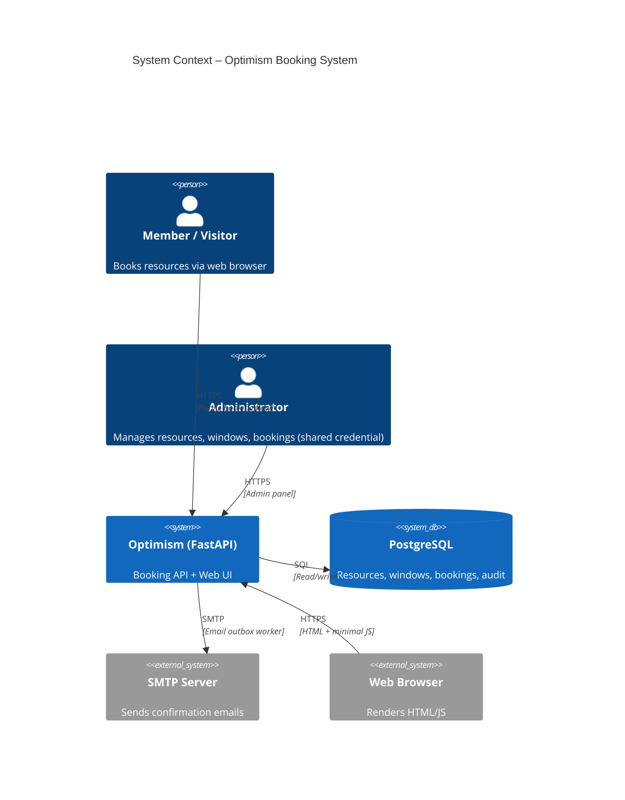

# 3. Context and Scope

## 3.1 Business Context

## 3.2 External Interfaces

| Interface | Consumer | Protocol | Data | Notes |
|-----------|----------|----------|------|-------|
| **Public Web UI** | Members/Visitors | HTTPS (HTML) | Forms, calendar JSON | Server-rendered; minimal JS for FullCalendar |
| **Admin Web UI** | Administrators | HTTPS (HTML) | Forms, tables | Authenticated via session cookie |
| **Internal API** | Web UI (server-side) | HTTP (JSON) | REST `/api/v1` | Not exposed publicly; rate-limited |
| **Email** | Members/Admins | SMTP | Confirmation, notifications | Outbox worker; retry/dead-letter |
| **Database** | Optimism app | PostgreSQL wire | SQL | Single writer (app); migrations via Alembic |
| **Metrics** | Prometheus | HTTP `/metrics` | Prometheus exposition | Scraped by monitoring stack |
| **Logs** | Log aggregator | stdout (JSON) | Structured events | Correlation IDs, no PII |

## 3.3 Scope Boundaries

### In Scope (v1)
- Resource types, resources, availability windows (per resource, per weekday, fixed UTC times)
- One-off exceptions (holidays, closures)
- Public booking flow: choose resource → choose time → enter details → confirmation
- Cancellation/amendment up to configurable cutoff before start
- Admin CRUD for all domain entities + booking list/detail/cancel/amend
- Shared-admin authentication (salted hash, secure session, CSRF)
- Email confirmation (preserve current wording/subject)
- Observability: JSON logs, Prometheus metrics, health endpoints
- Single Docker image, migration-before-traffic deployment

### Out of Scope (v1)
- Public API for third parties
- Multi-user accounts, SSO, MFA
- Recurring bookings, waitlists, quotas per user
- Mobile app / PWA
- Cross-midnight slots
- Backup/restore automation (manual process acceptable initially)
- GDPR tooling (export/delete/consent)

---

> **Traceability**: [Evaluation §5, §6](../../EVALUATION.md), [Summary §Key Decisions](../../summary.md).