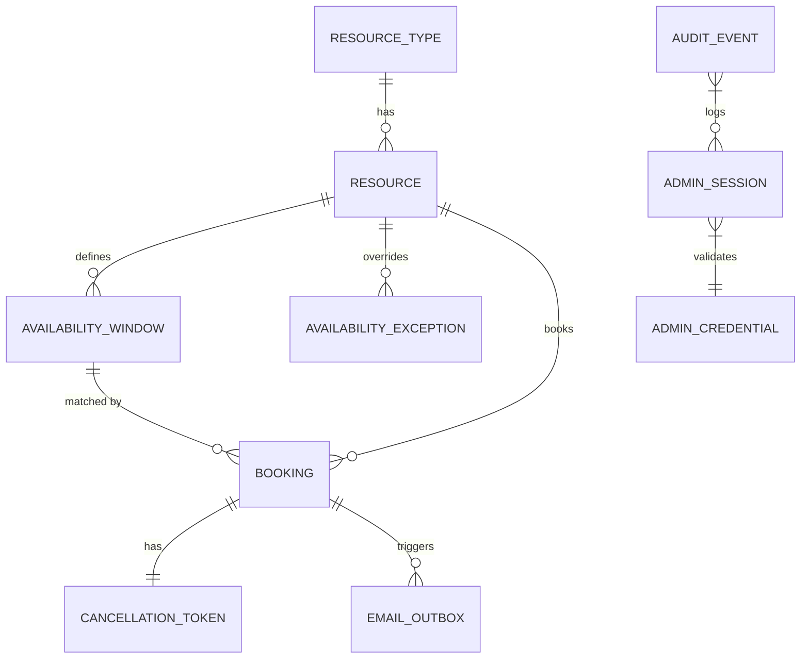

# 5. Building Block View

## 5.1 Top-Level Module Structure

```text
app/
├── main.py                 # FastAPI factory, lifespan, middleware, routers
├── core/
│   ├── config.py           # Pydantic Settings (typed env vars)
│   ├── security.py         # Password hashing, session middleware, CSRF
│   ├── logging.py          # structlog configuration, correlation IDs
│   ├── metrics.py          # Prometheus metrics exposition
│   └── exceptions.py       # RFC 7807 problem details, global handlers
├── db/
│   ├── engine.py           # SQLAlchemy engine/session factory
│   ├── base.py             # Declarative base, naming convention
│   └── session.py          # Request-scoped session dependency
├── models/                 # SQLAlchemy ORM models (one per domain)
│   ├── resource_type.py
│   ├── resource.py
│   ├── availability_window.py
│   ├── availability_exception.py
│   ├── booking.py
│   ├── cancellation_token.py
│   ├── email_outbox.py
│   ├── admin_session.py
│   └── audit_event.py
├── domains/
│   ├── resources/
│   │   ├── repository.py
│   │   ├── service.py
│   │   ├── schemas.py      # Pydantic request/response
│   │   └── router.py       # /api/v1/resources, /api/v1/resource-types
│   ├── windows/
│   │   ├── repository.py
│   │   ├── service.py
│   │   ├── schemas.py
│   │   └── router.py       # /api/v1/availability-windows, exceptions
│   ├── bookings/
│   │   ├── repository.py
│   │   ├── service.py      # availability, capacity lock, cancellation window
│   │   ├── schemas.py
│   │   ├── router.py       # /api/v1/bookings, /cancel/:token
│   │   └── worker.py       # email outbox processor
│   └── admin/
│       ├── auth.py         # login/logout, session deps
│       ├── schemas.py
│       └── router.py       # /admin/* (HTML + JSON)
├── web/                    # Server-rendered public pages
│   ├── router.py           # /, /select-a-resource, /select-a-time, ...
│   ├── templates/          # Jinja2 templates (public + admin)
│   └── static/             # CSS, bundled JS (FullCalendar)
├── migrations/             # Alembic versions
└── tests/
    ├── unit/               # Domain rules, schemas, utilities
    ├── integration/        # DB + API (real PostgreSQL via testcontainers)
    ├── api/                # Contract tests for /api/v1
    ├── e2e/                # Playwright journeys (public + admin)
    └── factories/          # Typed test data builders
```

## 5.2 Key Building Blocks (Level 2)

### 5.2.1 `core.config.Settings`
- Single source of truth for all environment variables
- Pydantic `BaseSettings` with validation, defaults (see [Configurable Constants](#configurable-constants))
- Injected via FastAPI `Depends(get_settings)`

### 5.2.2 `db.session.get_session`
- Request-scoped `AsyncSession` (or sync `Session`) via FastAPI dependency
- Commits on success, rolls back on exception
- Used by repositories only

### 5.2.3 Domain Repositories
| Repository | Responsibility |
|------------|----------------|
| `ResourceTypeRepository` | CRUD + list for `resource_types` |
| `ResourceRepository` | CRUD + list + window assignment |
| `AvailabilityWindowRepository` | CRUD + query by resource/weekday; overlap validation |
| `AvailabilityExceptionRepository` | CRUD + date-range queries |
| `BookingRepository` | CRUD + overlap queries, token lookup, status transitions |
| `CancellationTokenRepository` | Hash storage, lookup, mark-used |
| `EmailOutboxRepository` | Enqueue, claim, mark-sent/failed, dead-letter |
| `AdminSessionRepository` | Create, validate, revoke, cleanup expired |
| `AuditEventRepository` | Append-only write; query for admin UI |

### 5.2.4 Domain Services
| Service | Key Operations |
|---------|----------------|
| `AvailabilityService` | `get_windows_for_range(resource_id, start, end)` → list of windows with status (`available`/`unavailable`) |
| `BookingService` | `create_booking(...)`, `cancel_booking(token)`, `amend_booking(...)`, `check_capacity(window_id, start, end)` |
| `EmailWorker` | Poll outbox, send via SMTP, retry with exponential back-off, dead-letter on max attempts |

### 5.2.5 API Routers (JSON)
| Router | Endpoints | Auth |
|--------|-----------|------|
| `resources.router` | `GET/POST /resources`, `GET/PUT/DELETE /resources/{id}`, `GET/PUT /resources/{id}/windows` | Admin (write), Public (read windows) |
| `windows.router` | `GET/POST /availability-windows`, `GET/PUT/DELETE /availability-windows/{id}`, `GET/POST /availability-exceptions` | Admin |
| `bookings.router` | `GET/POST /bookings`, `GET /bookings/{id}`, `POST /bookings/cancel/{token}` | Public (create/cancel), Admin (list) |
| `admin.router` | `POST /admin/login`, `POST /admin/logout`, HTML admin CRUD | Admin session |

### 5.2.6 Web Router (HTML)
- Public: `GET /`, `GET /select-a-resource`, `GET /select-a-time`, `POST /your-details`, `POST /confirmation`, `GET /cancel-booking/{token}`
- Admin: `GET /admin/*` (dashboard, resources, windows, exceptions, bookings)

## 5.3 Configurable Constants (Environment Variables)

| Variable | Default | Description |
|----------|---------|-------------|
| `RATE_LIMIT_BOOKING_CREATE` | `10/minute` | Booking creation per IP |
| `RATE_LIMIT_CALENDAR_READ` | `60/minute` | Calendar reads per IP |
| `BOOKING_CANCELLATION_CUTOFF_MINUTES` | `5` | Minutes before start to allow cancel/amend |
| `EMAIL_RETRY_BASE_DELAY_SECONDS` | `60` | Initial back-off |
| `EMAIL_RETRY_MAX_ATTEMPTS` | `5` | Max delivery attempts |
| `EMAIL_RETRY_MAX_DELAY_SECONDS` | `960` | Cap on back-off (16 min) |
| `OBSERVABILITY_ALERT_5XX_RATE` | `0.01` | 5xx rate alert threshold |
| `OBSERVABILITY_ALERT_EMAIL_BACKLOG` | `100` | Outbox backlog alert |
| `OBSERVABILITY_ALERT_DB_POOL_EXHAUSTION` | `true` | Pool exhaustion alert |

All read via `core.config.Settings` (Pydantic `BaseSettings`).

## 5.4 Data Model Overview



### Key Constraints (enforced in PostgreSQL)
- `availability_window`: `ends_at > starts_at`, `weekday 0..6`, unique `(resource_id, weekday, starts_at, ends_at)`, **exclusion constraint** preventing overlapping windows for same resource/weekday
- `booking`: `starts_at < ends_at`, `resource_id` NOT NULL, `status` enum, unique `cancellation_token.token_hash`
- `availability_exception`: `kind IN ('closed','open')`, date range non-empty
- `email_outbox`: `status IN ('pending','sending','sent','failed','dead_letter')`, `attempts <= max_attempts`

---

> **Traceability**: [Evaluation §4.2](../../EVALUATION.md), [Implementation Plan §3–§5](../../IMPLEMENTATION_PLAN.md).