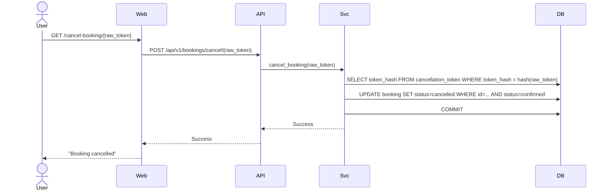
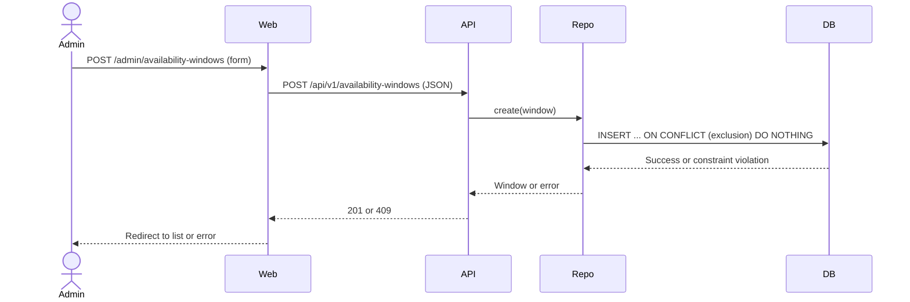

# 6. Runtime View

## 6.1 Key Scenarios

### 6.1.1 Public Booking Flow (Happy Path)

```mermaid
sequenceDiagram
    actor User
    participant Web as Web UI (Jinja)
    participant API as API Router
    participant Svc as BookingService
    participant DB as PostgreSQL
    participant Email as EmailWorker

    User->>Web: GET /select-a-resource
    Web->>API: GET /api/v1/resources
    API-->>Web: List resources
    Web-->>User: Render resource cards

    User->>Web: GET /select-a-time?resource=1
    Web->>API: GET /api/v1/availability-windows?resource=1&start=...&end=...
    API->>Svc: get_windows_for_range(...)
    Svc->>DB: SELECT windows + exceptions + bookings
    DB-->>Svc: Raw data
    Svc-->>API: Windows with status (available/unavailable)
    API-->>Web: Calendar JSON
    Web-->>User: Render FullCalendar (JS fetches weeks)

    User->>Web: Click available slot → POST /your-details
    Web->>Web: Validate resource matches session
    Web-->>User: Render details form

    User->>Web: POST /confirmation (name, email, notes)
    Web->>API: POST /api/v1/bookings {resource_id, starts, ends, ...}
    API->>Svc: create_booking(...)
    Svc->>DB: BEGIN; advisory lock(resource/window)
    Svc->>DB: Check capacity (count active bookings)
    Svc->>DB: INSERT booking (status=confirmed, token_hash)
    Svc->>DB: INSERT email_outbox (pending)
    Svc->>DB: COMMIT
    Svc-->>API: Booking + raw token
    API-->>Web: Booking JSON
    Web-->>User: Confirmation page + cancellation link (raw token)

    Email->>DB: Poll outbox (pending)
    Email->>SMTP: Send confirmation (raw token in link)
    Email->>DB: Mark sent
```

### 6.1.2 Cancellation by User



### 6.1.3 Admin CRUD (e.g., Create Availability Window)



## 6.2 Concurrency Handling

| Scenario | Mechanism |
|----------|-----------|
| **Booking creation** | `pg_advisory_xact_lock(resource_id, window_id)` or `SELECT ... FOR UPDATE` on window row; capacity check + insert in same transaction |
| **Email outbox worker** | `SELECT ... FOR UPDATE SKIP LOCKED` to claim pending entries; max 1 worker per container (or leader election if scaled) |
| **Admin session cleanup** | Background task deletes expired sessions hourly |

## 6.3 Error Handling & Retry

| Failure Point | Response |
|---------------|----------|
| DB constraint violation (overlap, duplicate) | 409 Conflict with RFC 7807 body |
| Invalid input (Pydantic validation) | 422 Unprocessable Entity |
| AuthN/AuthZ failure | 401 / 403 with generic message |
| SMTP transient error | EmailWorker retries with exponential back-off (configurable) |
| SMTP permanent error (after max attempts) | Mark `dead_letter`, alert via log/metric |
| DB connection pool exhausted | 503 Service Unavailable; alert fires |

## 6.4 Background Workers

| Worker | Trigger | Concurrency |
|--------|---------|-------------|
| `EmailWorker` | Polls `email_outbox` every 10s (configurable) | Single per process; `FOR UPDATE SKIP LOCKED` allows horizontal scaling |
| `SessionCleanup` | Cron (hourly) | Single |
| `Metrics` | `/metrics` scrape | Read-only |

## 6.5 Startup / Shutdown

- **Startup**: `lifespan` context in `main.py` → create engine, run Alembic `upgrade head` (if `AUTO_MIGRATE=1`), start background tasks
- **Shutdown**: Cancel background tasks, dispose engine, flush logs

---

> **Traceability**: [Evaluation §4.2, §7](../../EVALUATION.md), [Implementation Plan §3–§5](../../IMPLEMENTATION_PLAN.md).